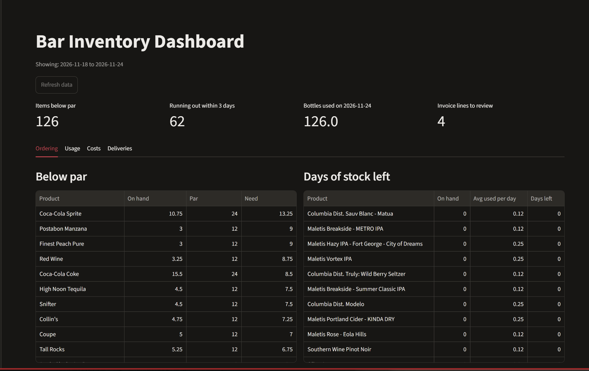
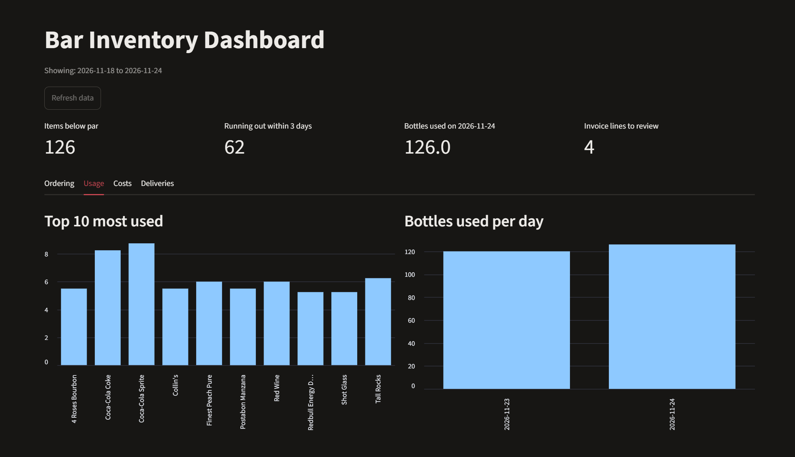
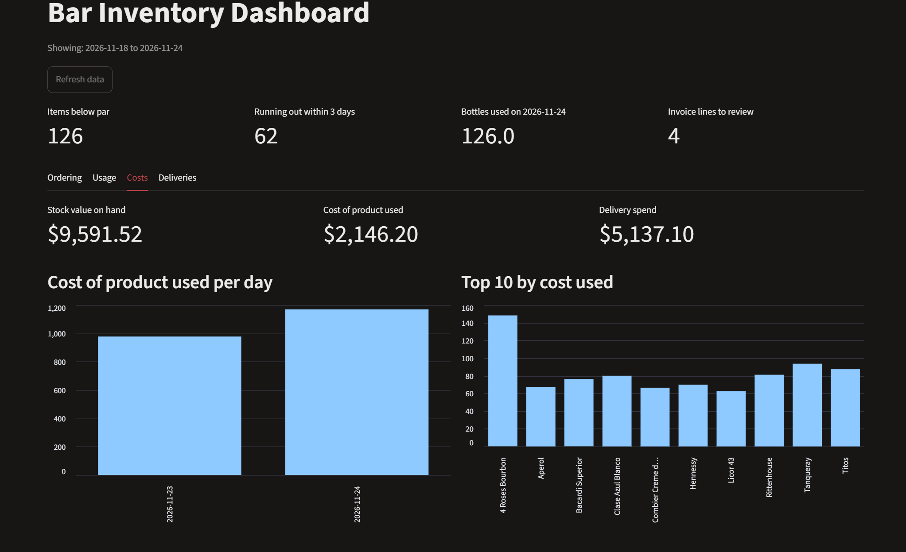
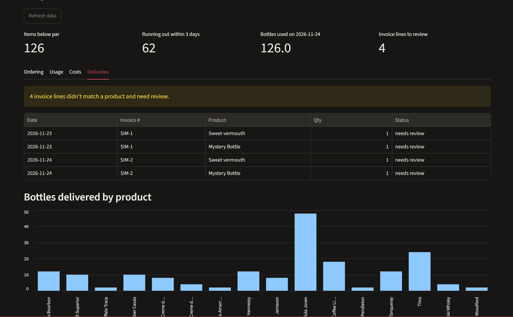
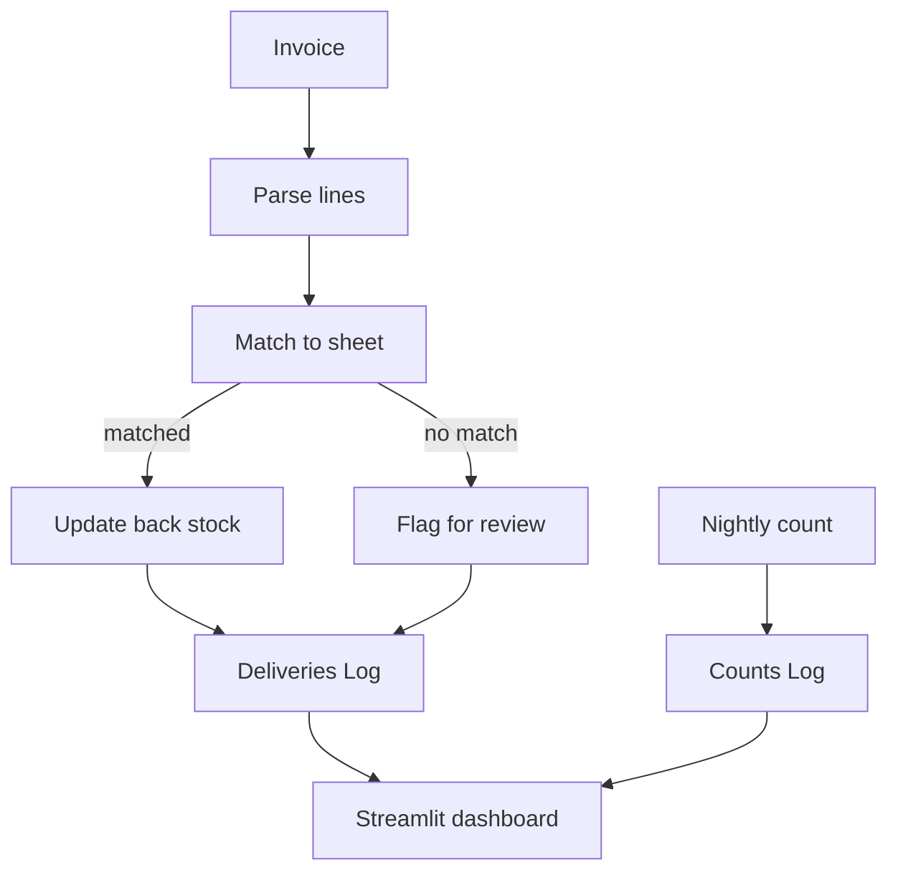

# # Bar Inventory Scanner

Automated invoice-to-inventory tracking and usage analytics for a working bar, built on the Google Sheet the bar already uses.



## The problem

Bar inventory is usually a spreadsheet that only shows what's on the shelf *right now*. Deliveries get typed in by hand, and there's no history, so nobody can answer: how much are we actually going through? What's running out? Where is the money going?

## What it does

- **Invoice → inventory:** reads a delivery invoice, matches each item to the inventory sheet, and updates back stock automatically

- **Never guesses:** anything it can't match is flagged for review instead of going to the wrong product

- **Builds history:** logs every delivery and saves a nightly count snapshot

- **Analytics dashboard:** below par, days of stock left, usage per bottle, cost of product used, and delivery spend, for any time period

## Screenshots

| Usage | Costs |

|---|---|

|  |  |



## How it works



Usage per product per day:

> **Used = last night's count + today's deliveries − tonight's count**

## Design decisions

- **Snapshot vs. history:** the inventory tab shows current state; the Deliveries and Counts logs keep every record, which is what makes usage and trend analytics possible

- **Dry run before writing:** every script shows what it will change and waits for confirmation

- **Duplicate protection:** an invoice number or a night's counts can't be logged twice

- **Business date:** closing after midnight still counts as the previous night's service

- **Messy data handling:** typos like `,5` and placeholders like `-` are cleaned in code, so the bar's sheet never has to change

- **Batch writes:** updates go to Google in one request to stay within API rate limits

- **Tested with a simulator:** resets a test sheet to par and simulates deliveries and sales, so the analytics can be checked against known answers

## Tech stack

Python · pandas · Streamlit · Google Sheets API (gspread)

## Project structure

| File | Purpose |

|---|---|

| `sheet_utils.py` | Shared helpers: connect, load products, clean values |

| `main.py` | Morning: process an invoice |

| `close_day.py` | Night: save the count snapshot |

| `dashboard.py` | Streamlit analytics dashboard |

| `simulate.py` | Test-only: reset to par and simulate days |

## Running it

```

pip install -r requirements.txt

python [main.py](http://main.py)          # process an invoice

python close_[day.py](http://day.py)     # save tonight's counts

streamlit run [dashboard.py](http://dashboard.py)

```

Requires a Google service account key `credentials.json`, not included) with access to the sheet.

## Roadmap

- OCR: photograph the invoice instead of typing it

- Fuzzy matching for distributor product names

- Profit and pour cost % from menu prices

- Variance: compare usage to Square POS sales to find over-pouring and waste